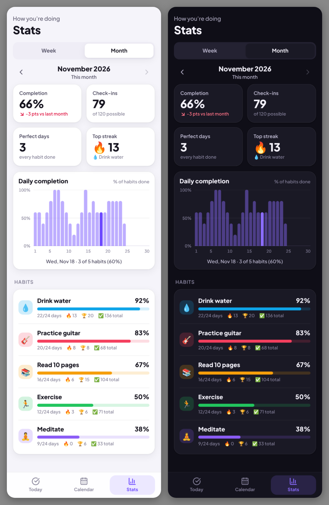
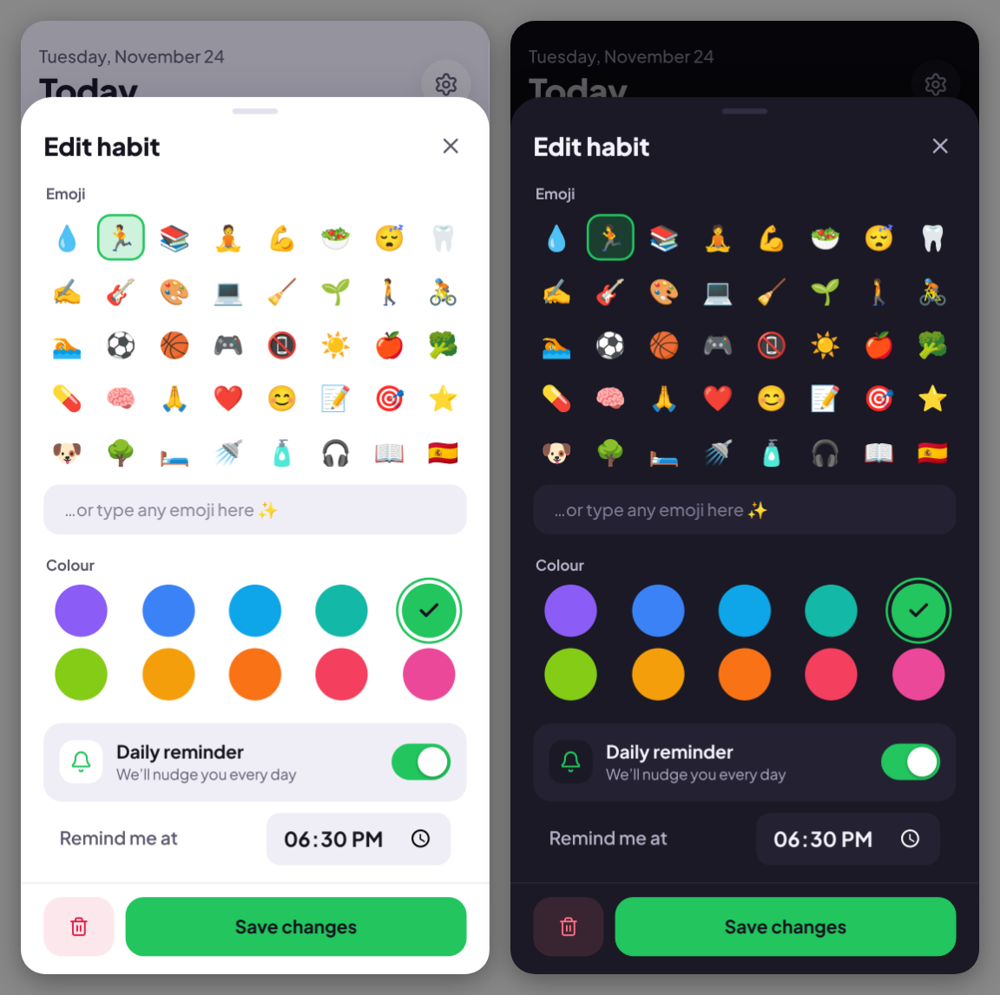

# ✅ Habit Tracker

A free, offline habit tracker for Android: no ads, no account, no subscription. Everything stays on your phone.

 

## Features

- **Habits your way**: name, emoji (pick one or type any emoji) and colour. Add, edit, delete.
- **Daily check-off** with a big tap target, a 🔥 **current streak** and 🏆 **best streak**, and confetti when you finish the day.
- **Fix missed days**: tap any day in the 7-day strip or the calendar.
- **Calendar + heatmap**: a month view where streaks join into pills, plus a 22-week heatmap. Look at one habit or all of them together.
- **Weekly & monthly stats**: completion %, change vs the last period, check-ins, perfect days, a daily bar chart and a per-habit leaderboard.
- **Daily reminders** per habit, at any time you choose. You won't get a reminder for a habit you've already done that day.
- **Works offline**. Data is saved on the device. **Export / Import** a backup file whenever you like.
- **Light, dark or automatic theme**, built for phones.

 

## 📲 Install on your Android phone

1. On your phone, open **https://github.com/tobyhome12345-commits/Habit-Tracker-App/releases/latest**
2. Under **Assets**, tap **`HabitTracker.apk`** to download it.
   (Direct link: https://github.com/tobyhome12345-commits/Habit-Tracker-App/releases/latest/download/HabitTracker.apk)
3. Open the downloaded file. If Android asks, allow **"Install unknown apps"** for your browser (Chrome → *Settings* → toggle **Allow from this source**), then go back.
4. Tap **Install**. If Google Play Protect warns about an unknown app, tap **More details → Install anyway**. (It says this for any app that isn't from the Play Store.)
5. Open **Habit Tracker** 🎉 When you turn on a reminder, tap **Allow** for notifications.

**Updating:** download the newest `HabitTracker.apk` the same way and install it over the top. Your habits and streaks are kept.

> ⚠️ Uninstalling the app deletes its data. Use **Settings → Export** first if you ever need to uninstall.

## How it's built

- **React + TypeScript + Vite** web app, wrapped as a native Android app with **Capacitor 8**.
- Storage: `@capacitor/preferences` (Android SharedPreferences). Reminders: `@capacitor/local-notifications`, scheduled on the device, no server.
- **GitHub Actions** (`.github/workflows/build-apk.yml`) runs the tests and builds a signed APK on every push, then publishes it as a GitHub Release.
- The APK is signed with `android/app/habit-tracker.keystore`, which is committed on purpose so that every build has the same signature and updates install cleanly. It's a personal sideloading key, not a Play Store key.

### Developing

```bash
npm install
npm run dev        # web preview at http://localhost:5173
npm test           # unit tests (dates, streaks, stats, storage)
npm run build      # production web build
npx cap sync android
```

Icons and splash screens come from the SVGs in `assets/`. Render them to PNG (`icon-only.png`, `icon-foreground.png`, `icon-background.png`, `splash.png`, `splash-dark.png`), then run `npx capacitor-assets generate --android`.
