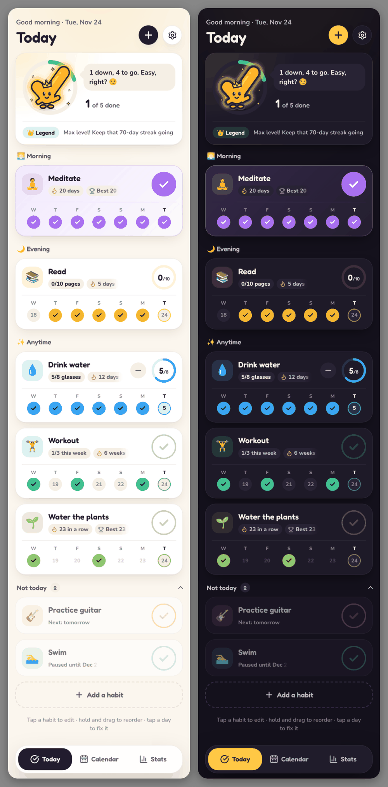
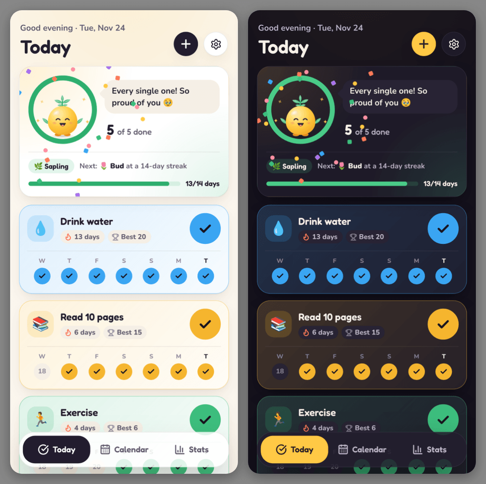
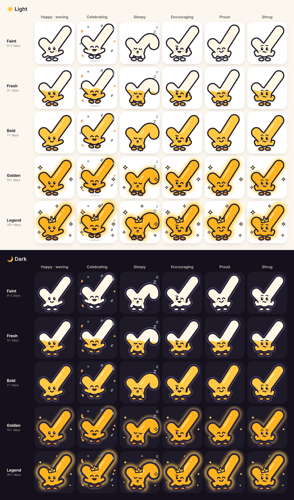
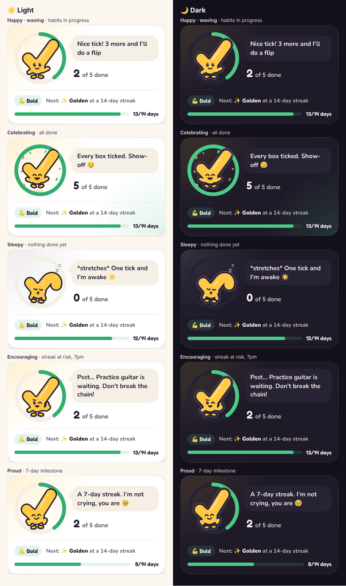
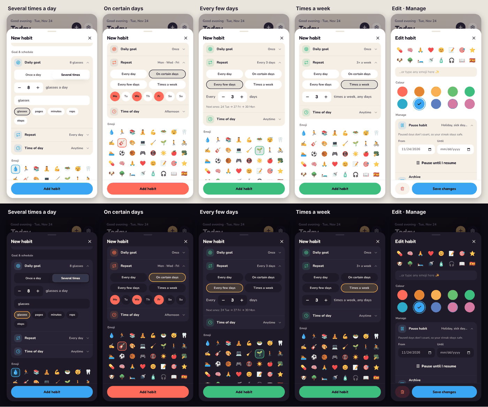
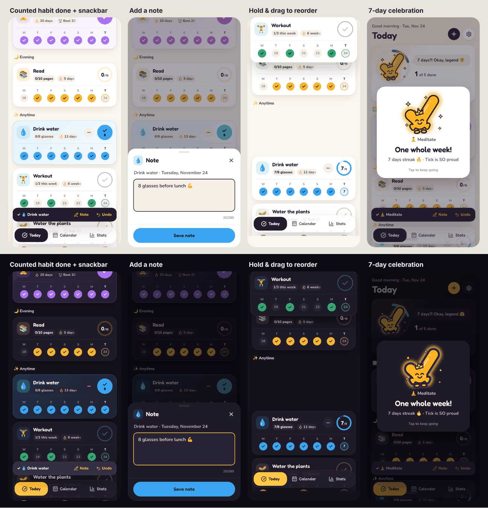
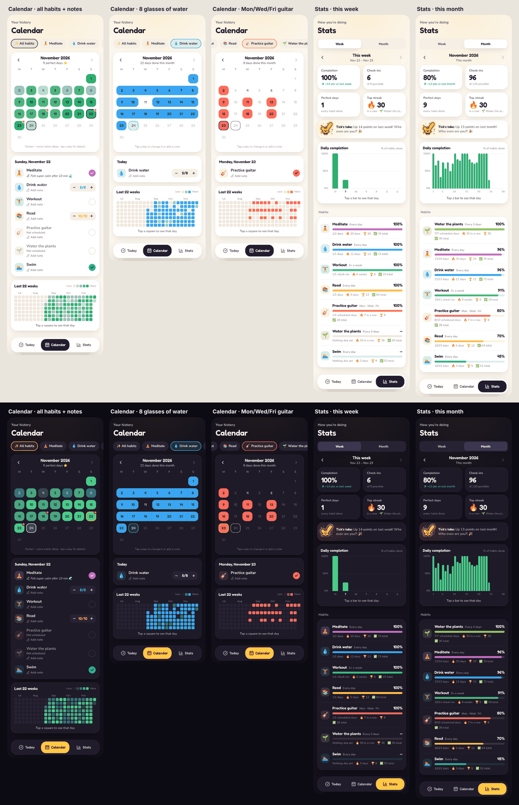
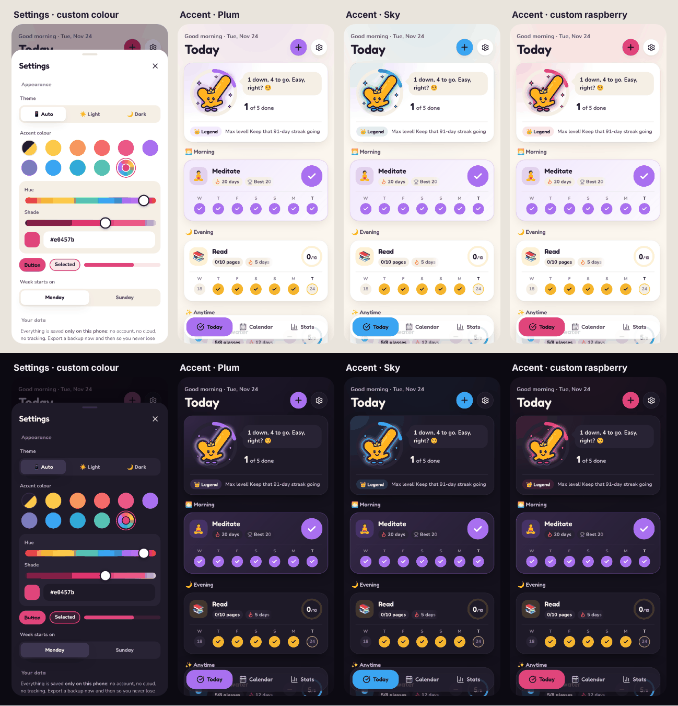
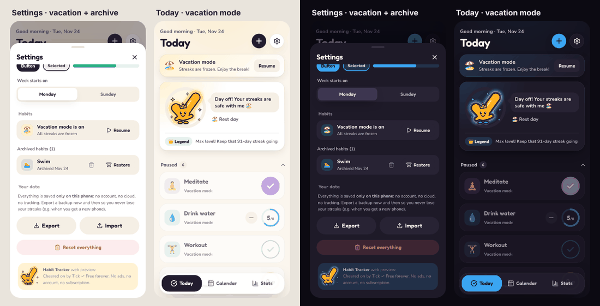
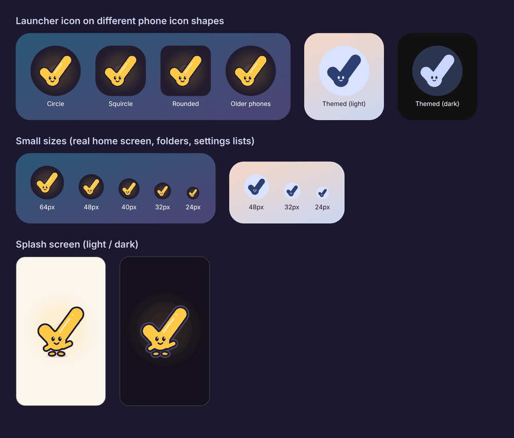

# ✅ Habit Tracker, with Tick

A free, offline habit tracker for Android: no ads, no account, no subscription. Everything stays on your phone.

 

## Meet Tick ✓

**Tick** is a living checkmark: chunky, yellow, a little cheeky and always on your side. He's drawn in a flat vector style with one thick outline.

- **Tick reacts to your day.** He's **sleepy** until your first check-off, then **happy and waving** while habits are in progress. He **cheers you on with a thumbs-up** when a 3+ day streak is still unticked after 6pm. He's **proud** on streak milestones and **jumps around with confetti** when everything's done. Check a habit off and he does a little hop.
- **Tick levels up** with your best current streak:
  ✏️ **Faint** (0–2 days, just an outline) → 🎨 **Fresh** (3+, filling with colour) → 💪 **Bold** (7+) → ✨ **Golden** (14+, glow + sparkles) → 👑 **Legend** (30+, with a crown).
- You'll find him on Today, in streak-milestone pop-ups, the empty states, Stats ("Tick's take"), the splash screen and the app icon.



 

## Features

**Habits your way**
- Name, emoji (pick one or type any) and colour from a 10-tone palette.
- **Daily goals**: a simple check, or a target you tap towards, like 💧 8 glasses or 📚 10 pages. Each tap fills a progress ring, there's a − button for mistakes, and you can add an optional unit.
- **Flexible schedules**: every day, specific days (Mon · Wed · Fri), every X days, or X times a week on any days.
- **Time of day**: Morning, Afternoon, Evening or Anytime. Today groups your habits that way.
- All the advanced options live in the add/edit sheet, folded into three tidy rows.

**Today**
- Tap to check off. You get a 🔥 **current streak**, a 🏆 **best streak**, and confetti when you finish the day.
- Habits that aren't due today move to a dimmed **"Not today"** section, with a reason like "Next: Wed" or "3/3 this week ✓".
- **Hold and drag** a habit to reorder it.
- After a check-off, a snackbar lets you **add a note** or **undo**.
- **Big celebrations** at 7, 30 and 100-day streaks, and smaller ones along the way.

**Streaks & stats that understand schedules**
- Skipped (unscheduled) days and paused days **never break a streak**. Only scheduled days count towards your completion %.
- Today never counts against you until it's over.
- "X times a week" habits keep weekly streaks and are judged on their weekly goal.
- Changing a habit's goal or schedule only applies from that day on. Your past streaks stay as they were.

**Calendar + heatmap**
- A month view for one habit or all of them, plus a 22-week heatmap.
- Tap any day to fix it, change its count or add a **note**. Days with notes get a dot.

**Weekly & monthly stats**
- Completion %, change vs the last period, check-ins and perfect days.
- A daily bar chart, and a per-habit list with each habit's schedule.

**Pause & archive**
- Pause one habit for a sick day, or turn on **🏖️ vacation mode** to pause everything. Both take an optional end date, and your streaks are frozen while paused.
- **Archive** habits you're done with. They keep their history and you can restore them anytime from Settings.

**Make it yours**
- Pick an **accent colour** for the whole app: 9 presets, or any custom colour.
- It recolours buttons, the tab bar, highlights and charts, plus Tick's glow and sneakers.
- Every colour is contrast-checked so text stays readable in light and dark mode.

**Your data**
- Works **offline**, with everything saved on the device.
- **Export / Import** backups include everything: goals, schedules, counts, notes, pauses, archive, order and accent.
- **Light, dark or automatic theme**, built for phones. Respects "reduce motion".













## 📲 Install on your Android phone

1. On your phone, open **https://github.com/tobyhome12345-commits/Habit-Tracker-App/releases/latest**
2. Under **Assets**, tap **`HabitTracker.apk`** to download it.
   (Direct link: https://github.com/tobyhome12345-commits/Habit-Tracker-App/releases/latest/download/HabitTracker.apk)
3. Open the downloaded file. If Android asks, allow **"Install unknown apps"** for your browser (Chrome → *Settings* → toggle **Allow from this source**), then go back.
4. Tap **Install**. If Google Play Protect warns about an unknown app, tap **More details → Install anyway**. (It says this for any app that isn't from the Play Store.)
5. Open **Habit Tracker** 🎉

**Updating:** download the newest `HabitTracker.apk` the same way and install it over the top. Your habits and streaks are kept.

> ⚠️ Uninstalling the app deletes its data. Use **Settings → Export** first if you ever need to uninstall.

## How it's built

- **React + TypeScript + Vite** web app, wrapped as a native Android app with **Capacitor 8**.
- **Design system:** "Garden notebook". Warm paper + ink by day, a night garden in dark mode. Fredoka + Nunito fonts (bundled, so they work offline). Tokens live in `src/styles/global.css`.
- **Tick** is drawn in code: `src/mascot/tick.ts` returns his SVG for any pose and level. `src/mascot/mood.ts` decides his mood, messages, level and milestones (all unit-tested).
- **Schedules:** `src/lib/schedule.ts` is the one place that decides whether a day is scheduled, paused or met. Streaks (`streaks.ts`), stats (`stats.ts`), Today, Calendar and Tick all use it.
- **Data model (v2):** each habit keeps versioned rules (`{ since, target, schedule }`), so edits never rewrite history. It also stores taps per day, notes, pauses, an archive date and an order. Old v1 saves and backups migrate automatically (`normalizeState` in `src/lib/storage.ts`).
- Storage: `@capacitor/preferences`, on the device, no server.
- **GitHub Actions** (`.github/workflows/build-apk.yml`) runs the tests and builds a signed APK on every push, then publishes it as a GitHub Release.
- The APK is signed with `android/app/habit-tracker.keystore`. It's committed on purpose, so every build has the same signature and updates install cleanly. It's a personal sideloading key, not a Play Store key.

### Developing

```bash
npm install
npm run dev        # web preview at http://localhost:5173
npm test           # unit tests (schedules, streaks, stats, storage + migration, colours, Tick)
npm run build      # production web build
npm run assets     # re-render app icon + splash images from Tick's SVG
npx cap sync android
```
