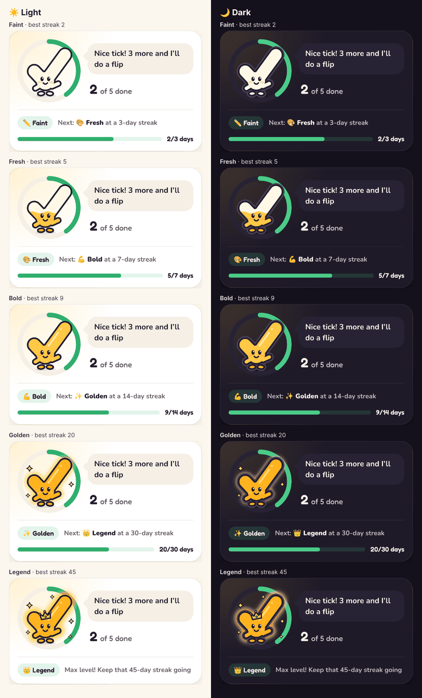
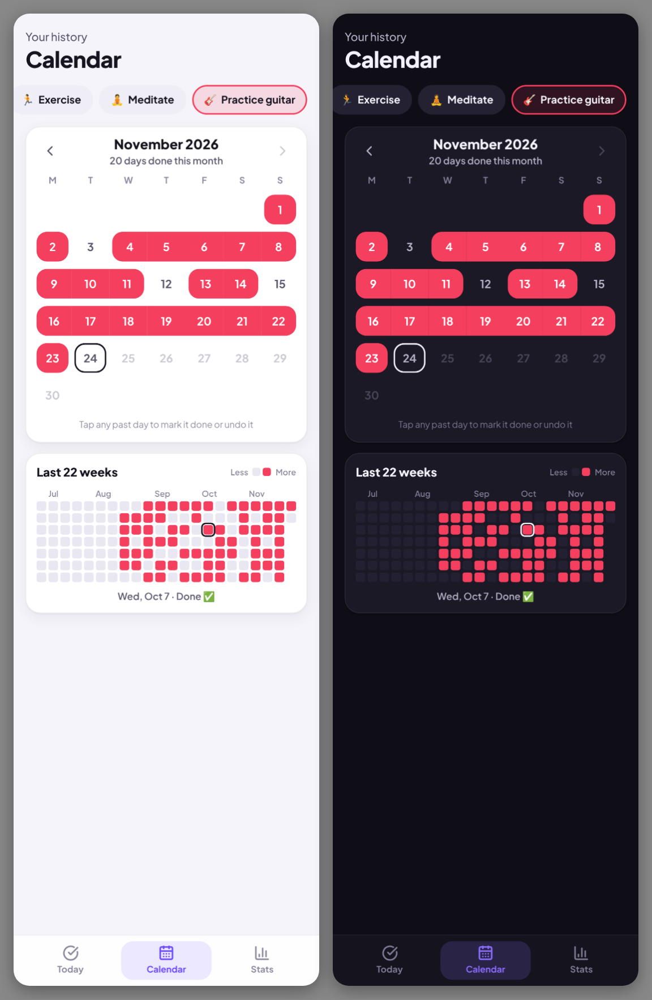

# ✅ Habit Tracker, with Tick

A free, offline habit tracker for Android: no ads, no account, no subscription. Everything stays on your phone.

 

## Meet Tick ✓

**Tick** is a living checkmark: chunky, yellow, a little cheeky and always on your side. He's drawn in a flat vector style with one thick outline.

- **Tick reacts to your day.** He's **sleepy** until your first check-off, then **happy and waving** while habits are in progress. He **cheers you on with a thumbs-up** when a 3+ day streak is still unticked after 6pm. He's **proud** on streak milestones and **jumps around with confetti** when everything's done. Check a habit off and he does a little hop.
- **Tick levels up** with your best current streak:
  ✏️ **Faint** (0–2 days, just an outline) → 🎨 **Fresh** (3+, filling with colour) → 💪 **Bold** (7+) → ✨ **Golden** (14+, glow + sparkles) → 👑 **Legend** (30+, with a crown).
- You'll find him on Today, in streak-milestone pop-ups, the empty states, Stats ("Tick's take"), the splash screen and the app icon.


 

## Features

- **Habits your way**: name, emoji (pick one or type any emoji) and colour from a 10-tone garden palette.
- **Daily check-off**: a big tap target with a check that draws itself in, a 🔥 **current streak**, a 🏆 **best streak**, and confetti when you finish the day.
- **Streak milestones** at 3, 7, 14, 21, 30, 50, 100… days.
- **Fix missed days** by tapping any day in the 7-day strip or the calendar.
- **Calendar + heatmap**: a month view where streaks join into pills, plus a 22-week heatmap, for one habit or all of them.
- **Weekly & monthly stats**: completion %, change vs the last period, check-ins, perfect days, a daily bar chart and a per-habit leaderboard.
- **Works offline.** Data is saved on the device, with **Export / Import** backups.
- **Light, dark or automatic theme**, built for phones. Respects "reduce motion".

 


## 📲 Install on your Android phone

1. On your phone, open **https://github.com/tobyhome12345-commits/Habit-Tracker-App/releases/latest**
2. Under **Assets**, tap **`HabitTracker.apk`** to download it.
   (Direct link: https://github.com/tobyhome12345-commits/Habit-Tracker-App/releases/latest/download/HabitTracker.apk)
3. Open the downloaded file. If Android asks, allow **"Install unknown apps"** for your browser (Chrome → *Settings* → toggle **Allow from this source**), then go back.
4. Tap **Install**. If Google Play Protect warns about an unknown app, tap **More details → Install anyway**. (It says this for any app that isn't from the Play Store.)
5. Open **Habit Tracker** 🎉

**Updating:** download the newest `HabitTracker.apk` the same way and install it over the top. Your habits and streaks are kept.

> ⚠️ Uninstalling the app deletes its data. Use **Settings → Export** first if you ever need to uninstall.

## How it's built

- **React + TypeScript + Vite** web app, wrapped as a native Android app with **Capacitor 8**.
- **Design system:** "Garden notebook". Warm paper + ink by day, a night garden in dark mode. Fredoka + Nunito fonts (bundled, so they work offline). Tokens live in `src/styles/global.css`.
- **Tick** is drawn in code: `src/mascot/tick.ts` returns his SVG for any pose and level. `src/mascot/mood.ts` decides his mood, messages, level and milestones (all unit-tested).
- Storage: `@capacitor/preferences`, on the device, no server.
- **GitHub Actions** (`.github/workflows/build-apk.yml`) runs the tests and builds a signed APK on every push, then publishes it as a GitHub Release.
- The APK is signed with `android/app/habit-tracker.keystore`. It's committed on purpose, so every build has the same signature and updates install cleanly. It's a personal sideloading key, not a Play Store key.

### Developing

```bash
npm install
npm run dev        # web preview at http://localhost:5173
npm test           # unit tests (dates, streaks, stats, storage, Tick's moods + artwork)
npm run build      # production web build
npm run assets     # re-render app icon + splash images from Tick's SVG
npx cap sync android
```
